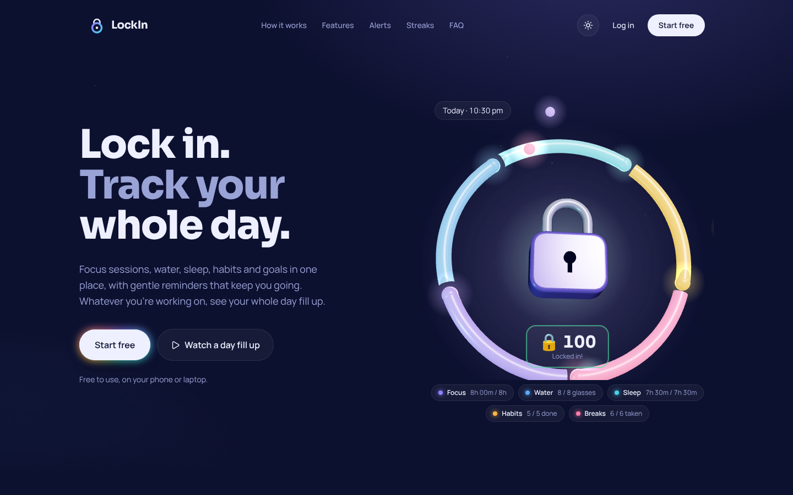
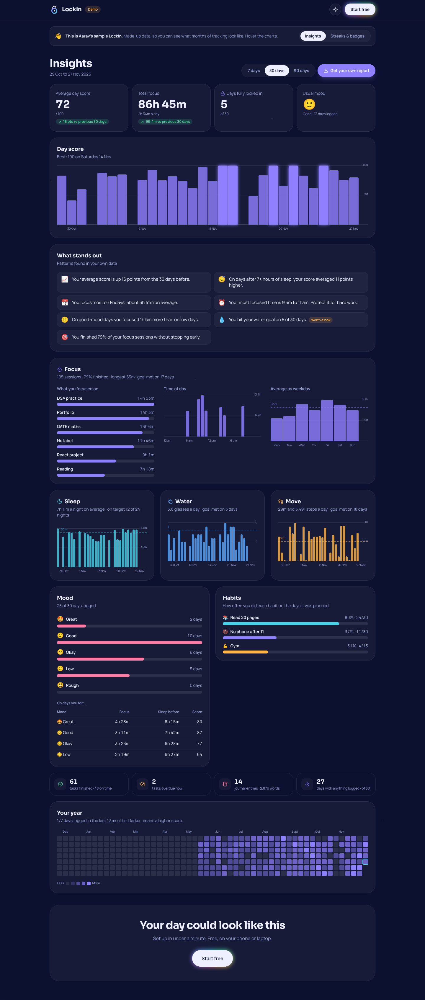
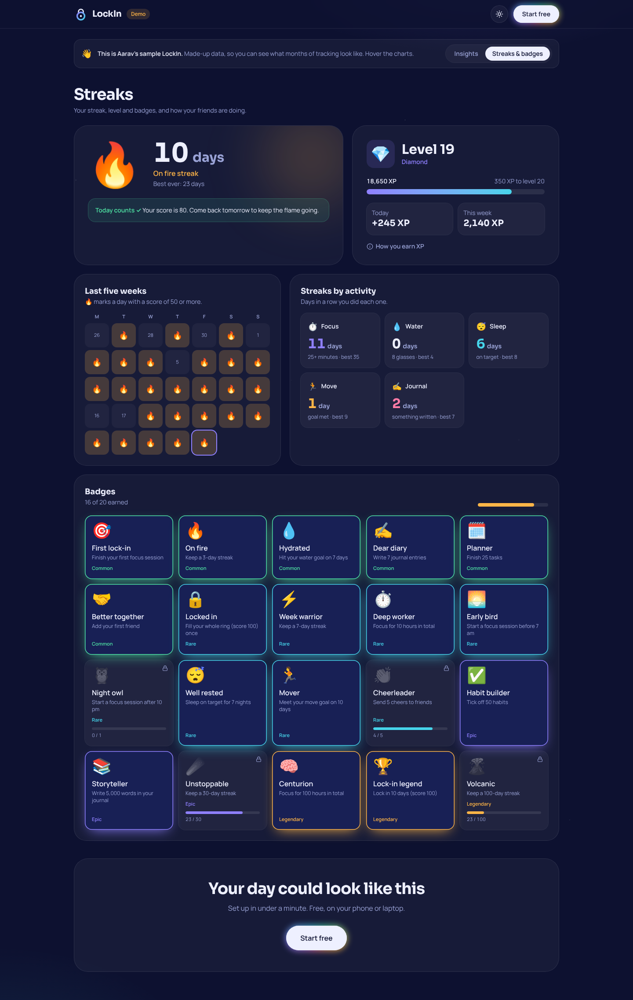
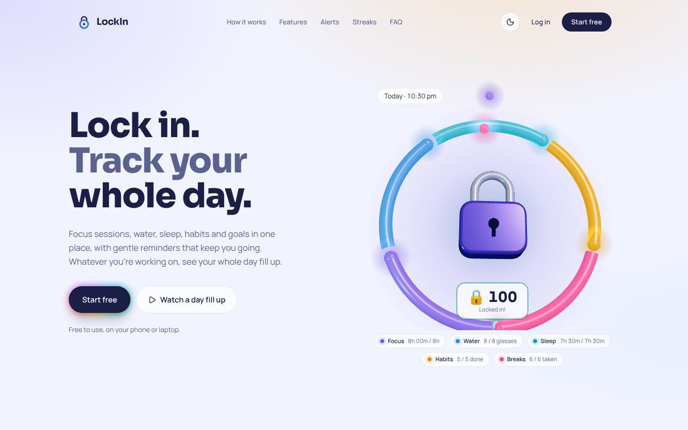
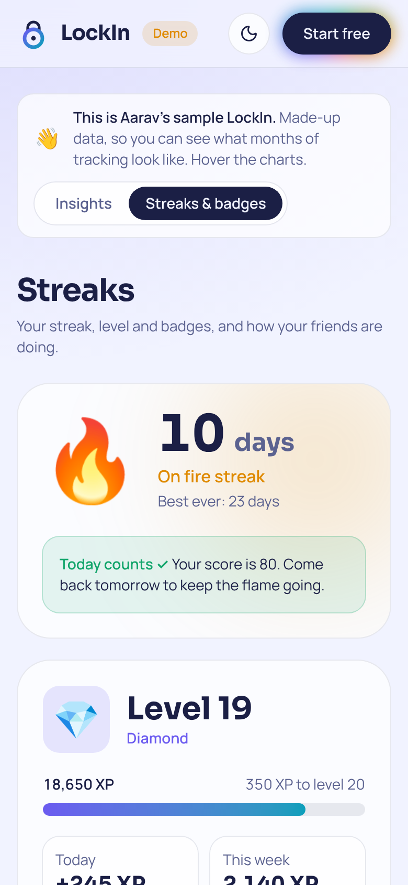
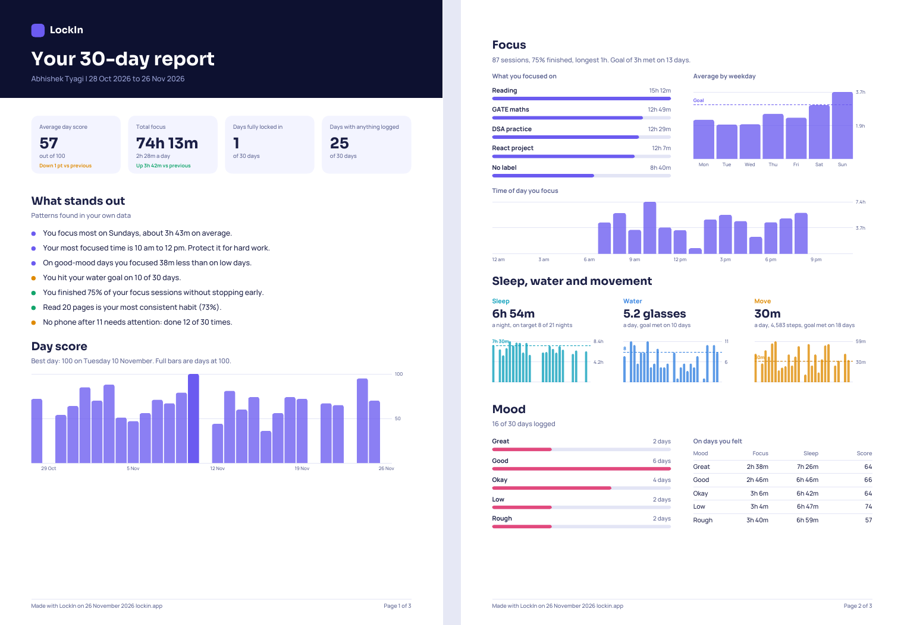

# LockIn: track your whole day

**LockIn is a self-improvement web app that puts your whole day in one place:** focus sessions, water, sleep, movement, habits, tasks, goals and a private journal. Everything you log fills a five-part **day ring**, and when the ring is full, you're "locked in". Reminders with their own sounds, streaks, XP, badges, friends, insights with a PDF report and an admin panel sit on top.

**Live app:** https://lockin-liart-iota.vercel.app  
**Try it without signing up:** https://lockin-liart-iota.vercel.app/demo



---

## What it does

| Area | What you can do |
| --- | --- |
| **Today** | Log water, focus, sleep, movement, steps, meals and mood. The day ring and score update instantly, and a small celebration plays at 100. |
| **Lock In mode** | A full-screen focus timer with presets, ambient sounds (rain, café, forest, waves, brown noise, all synthesized), breaks and distraction tracking. It survives a page reload. |
| **Habits** | Habits on any weekly schedule, with templates, streaks and a heatmap. |
| **Plan** | Tasks with priority, due date and estimate; a day timetable with a live "now" line; goals with milestones; a weekly top 3 and a weekly review. "Lock in for this" starts a timer for any block. |
| **Journal** | Daily prompts, three good things, a win, a lesson, free writing, tags, a calendar, search, "look back" and an export to Markdown. It saves as you type. Private by design: not even admins can read it. |
| **Alerts** | Water, breaks, eye rest (20-20-20), stretching, wind-down, morning and evening reminders, each with its own sound and animation. There's a guided breathing overlay, plus desktop notifications if you allow them. |
| **Insights** | 7, 30 or 90-day views: score trend, focus by topic, by hour and by weekday, sleep, water, movement, mood and habits, a year heatmap, and plain-English findings worked out from your own data. |
| **PDF report** | A 3-page A4 report generated on the server with vector charts and the app's own fonts. |
| **Streaks and XP** | A streak of days scoring 50 or more, levels with ranks (🌱 to 👑), 20 badges with progress bars, and streaks for each activity. |
| **Friends** | Add friends by username, a weekly leaderboard, and cheers (one a day). Friends only ever see a summary. |
| **Admin panel** | Overview charts, people search, a per-person summary, admin roles, account pausing, a feedback inbox, announcements and a tamper-proof activity log. |
| **Everywhere** | Dark and light themes, a phone tab bar, an installable app (PWA) with an offline page, reduced-motion support and keyboard focus styles. |

## Screenshots

| Insights (demo data) | Streaks, levels and badges |
| --- | --- |
|  |  |

| Light theme | On a phone | PDF report |
| --- | --- | --- |
|  |  |  |

## How it's built

- **Next.js 16 (App Router)** with React Server Components and Server Actions. Pages load data on the server; changes go through validated server actions.
- **Supabase (Postgres + Auth)**: email and password sign-up with verification and password reset (a Google sign-in button is built in and needs only the provider switched on).
- **Tailwind CSS v4** with a small design system: two themes, "glass" surfaces, Sora and Manrope fonts.
- **Motion** for interface animation, plus a **three.js** 3D day ring on the landing page. The ring loads lazily, pauses when it's off screen, and falls back to 2D without WebGL.
- **Web Audio API**: every sound (alerts, ambient noise) is synthesized in the browser. There are no audio files.
- **pdf-lib** for server-generated PDF reports, with embedded fonts and vector charts.
- **Vercel** hosting in the Mumbai region, close to the database and the users.

### Design decisions worth a look

- **One scoring function, in one place.** The day score is the average of the ring's parts: focus, water, sleep, movement, habits (only on days that have habits) and journal. It's computed on the server on every save, so the score can't be faked from the browser.
- **Only changed fields are saved.** Fast taps (three glasses of water in a second) can't overwrite each other.
- **XP and streaks are computed by the database** from what you logged, not stored as a number someone could edit.
- **A save never spins forever.** Every save has a 15-second safety net that turns a lost connection into a clear message.
- **Insights are pure functions,** shared by the page and the PDF, so both always show the same numbers.

## Security and privacy

- **Row-level security on every table.** People can only read and write their own rows. Table and column grants are explicit (the automatic grants are switched off).
- **Column-level grants on profiles:** you can edit your settings but never your own role or account status.
- **The journal is private,** even from admins. Its policy has no admin exception.
- **Friends see a summary only** (streak, XP, level, today's score). That comes from a locked-down database function, never from your tables. Until a request is accepted, the sender only sees the username they typed.
- **Admin actions go through checked functions.** Every one is written to an audit log, and admins can't remove their own admin rights.
- **Pausing an account is enforced by the database** with restrictive policies on all 13 data tables, so it isn't just hidden in the interface.
- **Rate limits** on feedback (10 a day) and cheers (one per friend per day), plus input validation on every server action.

## Data model

`profiles` · `day_logs` · `focus_sessions` · `habits` · `habit_checks` · `tasks` · `goals` · `milestones` · `timetable_blocks` · `weekly_plans` · `journal_entries` · `alert_events` · `friendships` · `cheers` · `announcements` · `feedback` · `admin_audit`

The SQL for each step is in [`supabase/`](supabase), in the order it was built (Day 2 to Day 11).

## Run it locally

1. Create a Supabase project, then run the files in `supabase/` in order (day2 → day11) in the SQL editor.
2. Create a file called `.env.local` with your project's address and publishable key (Supabase → Project Settings → API):

   ```bash
   NEXT_PUBLIC_SUPABASE_URL=https://your-project.supabase.co
   NEXT_PUBLIC_SUPABASE_PUBLISHABLE_KEY=your-publishable-key
   ```

3. Install and start:

   ```bash
   npm install
   npm run dev
   ```

4. Open http://localhost:3000.

## Project structure

```
src/app            pages and server actions (today, focus, habits, plan, journal, insights, streaks, admin…)
src/components     interface, grouped by page; ui/ holds shared pieces
src/lib            scoring, insights, progress, PDF report, demo data, Supabase clients
supabase/          database schema, policies and functions, one file per build day
public/            app icons and the service worker
```

---

Built by **Abhishek Tyagi** · BTech CSE, MIET Meerut (2026)
